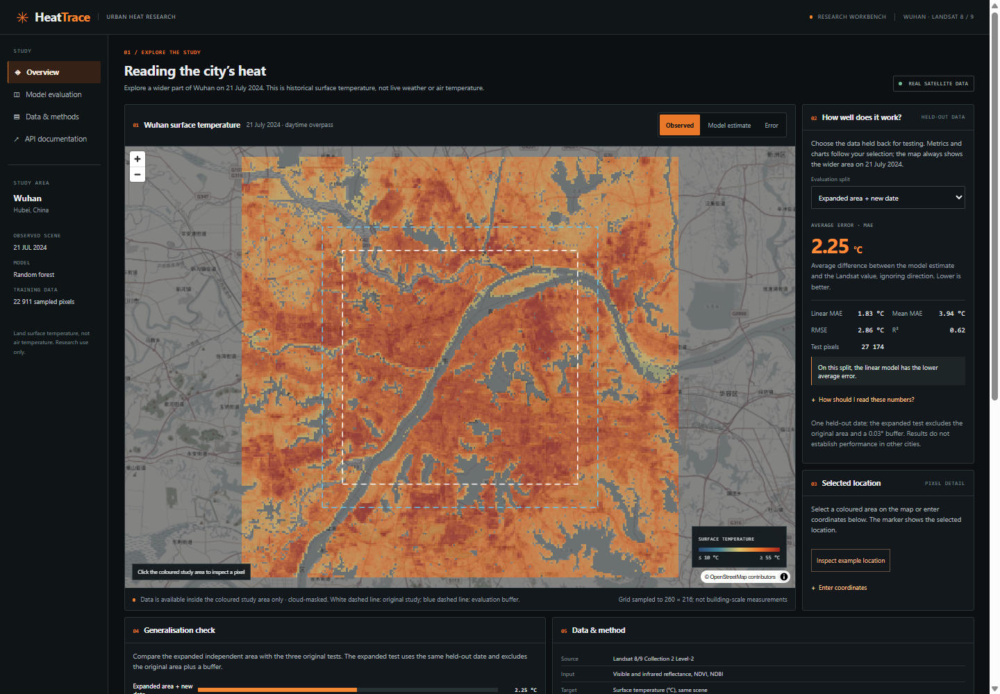
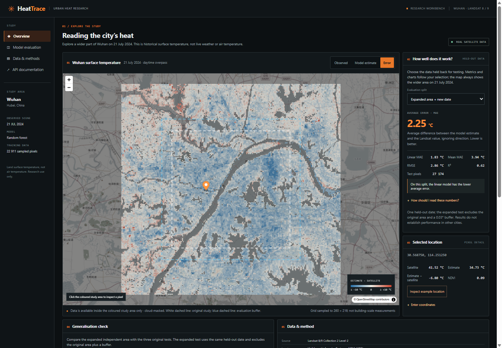
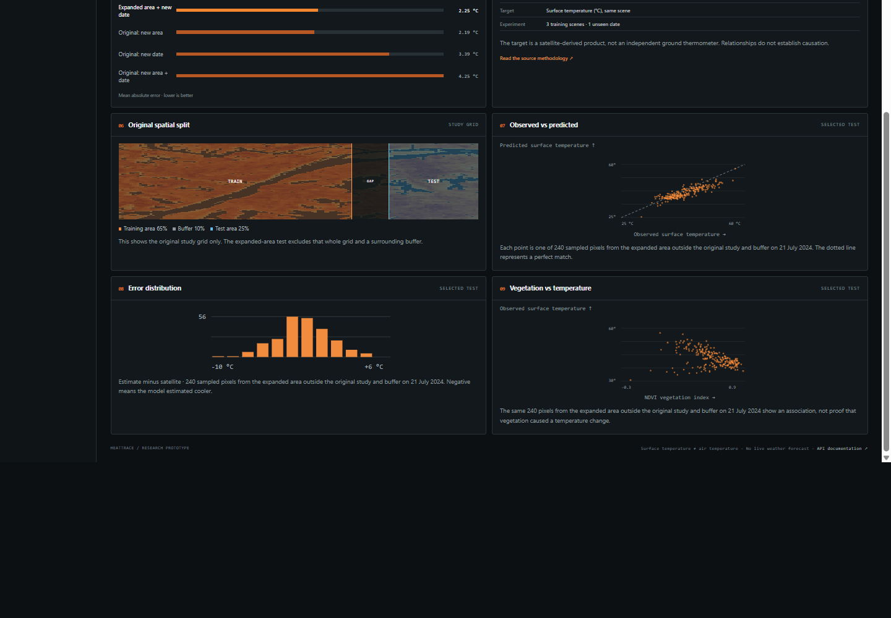

# HeatTrace

A local urban heat research workbench: compare Landsat surface temperature, a trained model, and errors on held-out Wuhan locations and dates. This is a small research study, not a live weather service.

The map now covers a larger rectangle, approximately 3.3 times the original rectangle's geographic area. The wider area is a separate analysis of the same held-out 21 July 2024 scene. The original data, model and results are preserved.

[Results and methodology](docs/RESULTS.md) · [Run locally](#run-on-windows) · [API](#api) · [Screenshots](#explore-the-workbench)

## Explore the workbench



The overview displays satellite observations and the model's test-set metrics. Switch the evaluation split to compare results across held-out locations and dates.



The error layer shows the signed difference between the forest estimate and the Landsat product. Select a location to compare the underlying values.



The charts use a reproducible sample of up to 240 test pixels; the reported metrics use all valid pixels in the chosen split.

## What the experiment asks

Can optical satellite measurements estimate the land surface temperature from the same satellite scene? The application displays the observed Landsat temperature, the model estimate and their difference. It does **not** predict future temperatures or measure air temperature.

Features: red, near-infrared and shortwave-infrared surface reflectance; NDVI and NDBI. Target: Landsat Collection 2 Level-2 surface temperature. A random forest is compared with a training-mean predictor and regularized linear regression. All three are fitted only on the western 65% of the grid from three scenes. A 10%-wide buffer separates that area from the eastern test region.

## Frozen results

| Evaluation | Pixels | Random forest MAE | Linear MAE | Mean MAE |
|---|---:|---:|---:|---:|
| Eastern area, 3 training dates | 9,179 | 2.19 °C | 2.32 °C | 3.58 °C |
| Western area, unseen date | 8,649 | 3.39 °C | 3.40 °C | 4.58 °C |
| Eastern area, unseen date | 3,636 | 4.25 °C | **3.88 °C** | 4.94 °C |
| Expanded area outside the original extent and buffer, unseen date | 27,174 | 2.25 °C | **1.83 °C** | 3.94 °C |

MAE is the average absolute difference from the satellite temperature product. The linear model outperforms the forest on both the original new-area/new-date split and the expanded-area split. The expanded split uses a different set of locations, so its lower error does not demonstrate model improvement. These results use one held-out date and are not global accuracy claims. See `data/output/report.json` and `data/expanded/report.json` for RMSE, R² and counts.

The map's **Error** layer is the signed estimate minus the satellite value for each displayed pixel; it is not the same as the average absolute error (MAE). Colours at or beyond the legend endpoints share the endpoint colour. The distribution and scatter charts switch with the selected evaluation split and show a deterministic sample of up to 240 pixels from that split. The reported MAE uses all valid pixels in the split. The interface lets users select map locations or enter coordinates, and explains MAE, RMSE and R² in the metric panel.

## Run on Windows

Tested with Python 3.11, Node.js and npm. From the repository root:

```powershell
python -m venv .venv
.venv\Scripts\python.exe -m pip install -r requirements.lock.txt
cd web
npm ci
npm run build
cd ..
.venv\Scripts\python.exe -m uvicorn heattrace.api:app --host 127.0.0.1 --port 8775
```

Open <http://127.0.0.1:8775/>. The API and interactive documentation are at <http://127.0.0.1:8775/docs>. The base map loads OpenStreetMap tiles over the internet; the prepared experiment and model run locally. The server must be started from the project root.

## Reproduce

Four prepared, cropped source grids are in `data/scenes/` with public STAC item references. To acquire them from scratch, move those files out of the directory and run `python -m heattrace.acquire` from the root. This downloads small windows of public Landsat Cloud Optimized GeoTIFFs, with short-lived access signatures held only in memory. Remote availability and rate limits are outside this project's control.

Then run:

```powershell
.venv\Scripts\python.exe -m heattrace.model
.venv\Scripts\python.exe -m heattrace.chart_samples
.venv\Scripts\python.exe -m heattrace.expanded
.venv\Scripts\python.exe -m pytest -q
```

The original experiment writes its report, three map layers, display grid and fitted model under `data/output/`. The separate expansion and its results are under `data/expanded/`. Expanding loads the frozen original forest and does not retrain it; the linear and mean baselines are reconstructed from original training data. The new evaluation excludes the complete original rectangle and an additional rectangular 0.03° geographic buffer on each side. This reduces direct spatial overlap but does not ensure independence from all spatial correlations. `requirements.lock.txt` and `web/package-lock.json` record the versions used. Results can vary across platforms and dependency versions. Only load model files from a trusted source: joblib deserialization can execute code.

## Data and limitations

- Source: USGS Landsat 8/9 Collection 2 Level-2, accessed through [Microsoft Planetary Computer STAC](https://planetarycomputer.microsoft.com/dataset/landsat-c2-l2). Source scene metadata and IDs are stored with each grid.
- The app masks pixel quality flags for fill, dilated cloud, cirrus, cloud, cloud shadow, snow and water, as well as missing bands. The separate radiometric saturation QA band is **not** currently used.
- Landsat surface temperature is a derived remote-sensing product, not a ground thermometer. Its derivation uses additional inputs including NDVI, so the optical features and target are not fully independent measurements.
- Grids use nearest-neighbour sampling and reprojection to 140 × 120 cells for the original area and 260 × 216 for the expanded area. These grids do not increase the instrument's actual resolution. Landsat thermal data are coarser than the 30 m product grid.
- Single snapshots, cloud masks, land cover and overpass conditions limit comparisons. We have not evaluated unseen cities, ground stations or more than one temporal holdout. The chosen spatial buffer reduces but cannot guarantee independence.
- Differences and feature relationships do not establish causes. Do not use this for health, hazard or urban-planning decisions.
- OpenStreetMap basemap tiles have their own [usage policy](https://operations.osmfoundation.org/policies/tiles/) and [attribution requirements](https://www.openstreetmap.org/copyright).

## API

`GET /api/report` returns provenance and metrics; `GET /api/chart-samples` returns reproducible samples for each holdout; `GET /api/layers/{observed|predicted|difference}.png` returns a map overlay; `GET /api/pixel?lat=...&lon=...` returns a sampled location or a masked-data reason when known. Interactive OpenAPI docs are available at `/docs`.

The larger extent has separate `/api/expanded/report`, `/api/expanded/layers/{filename}` and `/api/expanded/pixel` endpoints, so its measurements and evaluation cannot silently replace the original experiment.

## Sources

- [USGS Landsat Collection 2 Surface Temperature](https://www.usgs.gov/landsat-missions/landsat-collection-2-surface-temperature)
- [USGS scale factors](https://www.usgs.gov/faqs/how-do-i-use-a-scale-factor-landsat-level-2-science-products)
- [Spatial+ cross-validation research](https://research.utwente.nl/en/publications/spatial-a-new-cross-validation-method-to-evaluate-geospatial-mach/)
- [Yale Global Surface UHI Explorer](https://geospatial.yale.edu/global-surface-uhi-explorer)
